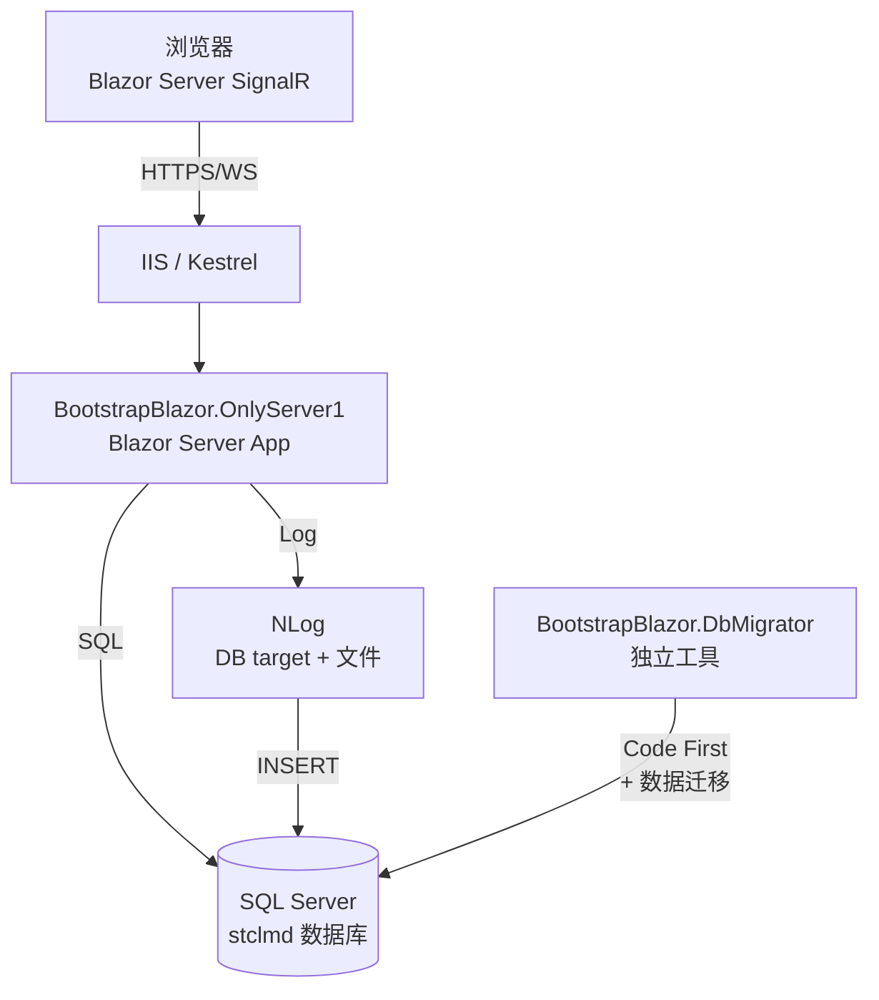
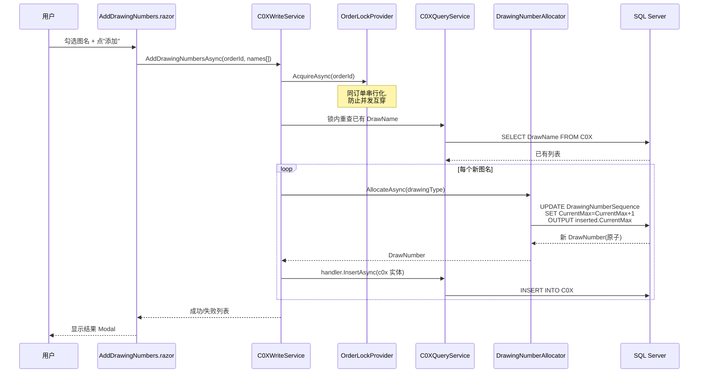
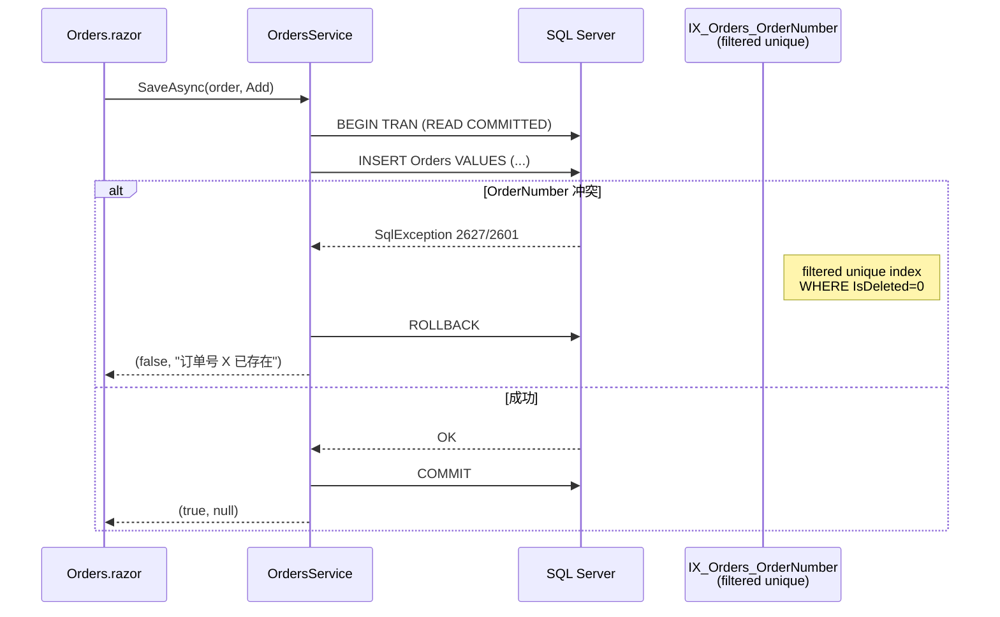
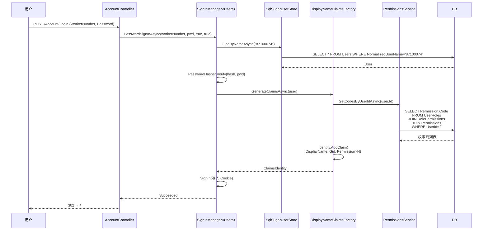

# 架构设计

## 系统拓扑



## 分层架构

```mermaid
graph TD
    Pages[Pages/<br/>Razor Components] -->|@inject| Services
    Controllers[Controllers/<br/>AccountController] --> Services
    Shared[Shared/<br/>MainLayout + LoginLayout] --> Pages

    subgraph Services["Services/ (业务层)"]
        IdSvr[Identity/<br/>SqlSugarUserStore]
        BizSvr[OrdersService<br/>UsersService<br/>RolesService<br/>DrawingNameService]
        DrawSvr[DrawingNumbers/<br/>C0XQueryService<br/>C0XWriteService]
        DrawType[DrawingTypes/<br/>Registry + 9 Handler]
        Alloc[DrawingNumberAllocator<br/>原子自增]
        Lock[OrderLockProvider<br/>进程内互斥]
    end

    Services --> Data
    IdSvr --> Data[Data/<br/>SqlSugarSetup<br/>SqlSugarScope 单例]

    Data --> DB[(SQL Server)]
```

### 各层职责

| 层 | 职责 | 不应做什么 |
|----|------|----------|
| **Pages (Razor)** | UI 渲染、用户交互、表单提交 | 不直接写 SQL;不直接 new Service |
| **Shared** | 布局、菜单、登录页布局 | 业务逻辑 |
| **Controllers** | MVC Controller 处理非 Blazor 表单(如 Login form post) | 不含业务逻辑,只调 Service |
| **Services** | 业务逻辑、事务、并发控制、缓存 | 不引用 UI 框架(BootstrapBlazor 类型) |
| **Identity Stores** | ASP.NET Core Identity 存储抽象 | 不写业务 |
| **Data** | SqlSugar 客户端初始化、AOP | 不含 SQL |

## 关键数据流

### 1. 添加图号(并发安全)



### 2. 保存订单(去重)



### 3. 登录(Identity + 业务 Claim)



## 9 张 C0X 表的抽象

```mermaid
classDiagram
    class C0XBase {
        <<abstract>>
        +int Id
        +int DrawNumber
        +string DrawName
        +int OrderId
        +string CreatedBy
        +DateTime CreatedTime
        +string UpdatedBy
        +DateTime UpdatedTime
        +bool IsDeleted
    }
    class C01
    class C02
    class C03
    class C04
    class C05
    class C06
    class C07
    class C08
    class C09

    C0XBase <|-- C01
    C0XBase <|-- C02
    C0XBase <|-- C03
    C0XBase <|-- C04
    C0XBase <|-- C05
    C0XBase <|-- C06
    C0XBase <|-- C07
    C0XBase <|-- C08
    C0XBase <|-- C09

    class IDrawingTypeHandler {
        <<interface>>
        +string DrawingType
        +CreateNewEntity(...)
        +InsertAsync(...)
        +FindByIdAsync(...)
    }
    class DrawingTypeHandlerBase~T~ {
        <<abstract>>
        +T 泛型约束
    }
    class C01Handler
    class C02Handler
    class ...
    class IDrawingTypeRegistry {
        +Resolve(string) IDrawingTypeHandler?
        +GetDrawingType(Orders) string?
        +GetSeedDrawingNumber(string) int
    }
    class DrawingTypeRegistry

    IDrawingTypeHandler <|.. DrawingTypeHandlerBase~T~
    DrawingTypeHandlerBase~T~ <|-- C01Handler
    DrawingTypeHandlerBase~T~ <|-- C02Handler
    IDrawingTypeRegistry <|.. DrawingTypeRegistry
    C01Handler --> C01
    C02Handler --> C02
```

**为什么用 abstract 基类 + 9 个具体子类**:
- SqlSugar Code First **不会**为 abstract 类建表,具体子类各建一张
- 每个子类表名硬编码(`[SugarTable("C01")]` 默认按类名),无需运行时反射
- `DrawingTypeHandlerBase<TEntity>` 模板方法消除 9 个 handler 的样板代码

## 配置外置的运行时可调项

| 配置 | appsettings 节 | 改动时 | 详见 |
|------|---------------|-------|------|
| 图号 Power 区间映射 | `BusinessRules.DrawingType.PowerRanges` | 改区间不动代码 | [configuration.md](configuration.md) |
| 电抗器 DrawingType | `BusinessRules.DrawingType.ReactorType` | 改值不动代码 | [configuration.md](configuration.md) |
| 图号种子值 | `BusinessRules.DrawingType.Seeds` | 改值不动代码 | [configuration.md](configuration.md) |
| Identity 密码策略 | `Identity.Password` | 改强度不动代码 | [configuration.md](configuration.md) |
| Identity 锁定策略 | `Identity.Lockout` | 改阈值不动代码 | [configuration.md](configuration.md) |

## 相关 ADR

- [ADR-0001: 用 SqlSugar 替代 EF Core](adr/0001-use-sqlsugar-instead-of-ef-core.md)
- [ADR-0002: 自定义 SqlSugar Identity Store](adr/0002-custom-identity-store-on-sqlsugar.md)
- [ADR-0003: 全项目统一 file-scoped namespace](adr/0003-file-scoped-namespace-convention.md)
- [ADR-0004: C0XBase abstract 多态](adr/0004-handle-base-c0x-with-abstract-class.md)
- [ADR-0005: 用 UNIQUE INDEX 替代 SERIALIZABLE](adr/0005-replace-serializable-with-unique-index.md)