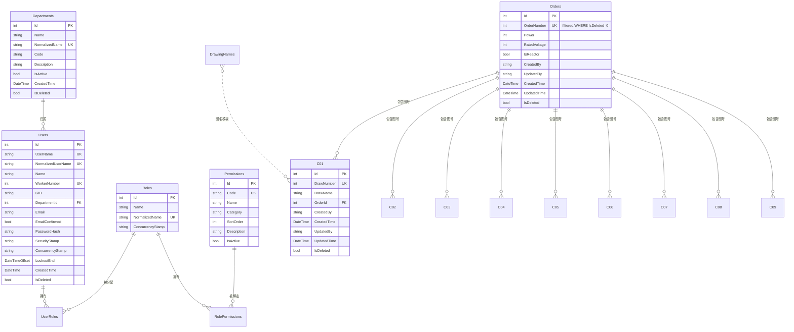

# 数据库文档

## 概述

- **DBMS**: SQL Server 2019+ Express(办公网单实例)
- **数据库名**: `stclmd`
- **ORM**: SqlSugar 5.1.4(Code First + 部分 SQL 演进)
- **迁移工具**: `BootstrapBlazor.DbMigrator`(独立命令行工具)

## ER 图(简化)



## 表清单

### 身份认证

| 表 | 用途 | 关键列 |
|----|------|-------|
| `Users` | ASP.NET Identity 用户 | `UserName` / `NormalizedUserName` / `WorkerNumber`(均 UNIQUE) |
| `Roles` | 角色(Admin/Operator/Viewer) | `Name` / `NormalizedName`(UK) |
| `UserRoles` | 用户-角色多对多 | 复合主键 `(UserId, RoleId)` |
| `UserClaims` | 用户额外 Claims(暂未使用) | `UserId` + `ClaimType`/`ClaimValue` |
| `RoleClaims` | 角色 Claims(暂未使用) | `RoleId` + `ClaimType`/`ClaimValue` |

### 权限系统

| 表 | 用途 | 关键列 |
|----|------|-------|
| `Permissions` | 25+ 细粒度操作权限码 | `Code`(UK)/`Category`/`SortOrder` |
| `RolePermissions` | 角色-权限多对多 | 复合主键 `(RoleId, PermissionId)`,FK CASCADE |

### 组织

| 表 | 用途 | 关键列 |
|----|------|-------|
| `Departments` | 部门 | `Name` / `NormalizedName`(UK) |

FK `Users.DepartmentId → Departments.Id`,ON DELETE NO ACTION(防止有员工引用时硬删)。

### 业务核心

| 表 | 用途 | 关键列 |
|----|------|-------|
| `Orders` | 订单主表 | `OrderNumber`(filtered UK `WHERE IsDeleted=0`)/`Power`/`IsReactor` |
| `C01` ~ `C09` | 9 张图号表(每张独立建表) | `DrawNumber`(UK)/`OrderId`(FK) |
| `DrawingNumberSequence` | 图号序列表(原子分配) | `DrawingType`(PK)/`CurrentMax` |
| `DrawingNames` | 图名基础数据(模板) | `ComponentName`/`Part`(注意:DB 列名 `Isdelete`,C# 用 `IsDeleted` + `ColumnName` 映射) |

### 日志

| 表 | 用途 | 关键列 |
|----|------|-------|
| `Logs` | NLog DB target 输出 | `Logged`/`Level`/`Message`/`Logger`/`Properties`/`Exception` |

> 表结构**严格对齐** `NLog.config` 的 INSERT,见 `Models/Logs.cs` 的 XML 注释。

## 关键字段说明

### `Orders.OrderNumber` — filtered unique index

```sql
CREATE UNIQUE INDEX IX_Orders_OrderNumber ON Orders(OrderNumber) WHERE IsDeleted = 0;
```

- **只约束活跃行**(`IsDeleted = 0`),软删订单保留原 OrderNumber
- 新建或修改时 DB 直接拒绝重复 → SqlException 2627/2601
- 应用层 `OrdersService.SaveAsync` catch 翻译成"订单号已存在"友好提示
- 详见 ADR 0005

### `C0XBase.DrawNumber` — 业务图号

- 9 张 C0X 表各自有 `IX_C0X_DrawNumber` UNIQUE 索引
- 分配走 `DrawingNumberAllocator.AllocateAsync`(原子 SQL)
- 表名冗余的 `DrawingType` 列已在 v2.0 删除(由表名推算)

### `Users.WorkerNumber` / `UserName` — 双重唯一

- `UserName` 和 `NormalizedUserName` 由 Identity 标准保证唯一
- `WorkerNumber` 是业务员工号,也加 UNIQUE 索引
- `UserName` 在 `UsersService.SaveAsync` 中同步为 `WorkerNumber.ToString()`

## 迁移流程

### 完整重置(开发环境)

```powershell
# 删除所有业务表 → 建表 → 灌种子 → 迁移历史数据
dotnet run --project BootstrapBlazor.DbMigrator -- --drop --schema --seed --migrate --source .
```

### 增量升级(生产环境)

```powershell
# 只跑 schema 演进(补列、加索引),不丢数据
dotnet run --project BootstrapBlazor.DbMigrator -- --schema
```

`EvolveSchemaAsync` 会:
1. 检测列是否存在,缺失则 `ALTER TABLE ADD`
2. 回填新列(用 `Seed + Id` 公式给 DrawNumber)
3. 加 `UNIQUE INDEX`(检测 `sys.indexes` 避免重复)
4. 给 C0X 表删除冗余 `DrawingType` 列

### 仅迁移数据

```powershell
dotnet run --project BootstrapBlazor.DbMigrator -- --migrate --source <path-to-sql-files>
```

## 索引清单

| 索引 | 表 | 列 | 类型 |
|------|----|----|------|
| `IX_Users_NormalizedUserName` | Users | NormalizedUserName | UNIQUE |
| `IX_Users_WorkerNumber` | Users | WorkerNumber | UNIQUE |
| `IX_Roles_NormalizedName` | Roles | NormalizedName | UNIQUE |
| `IX_Departments_NormalizedName` | Departments | NormalizedName | UNIQUE |
| `IX_Orders_OrderNumber` | Orders | OrderNumber (WHERE IsDeleted=0) | UNIQUE (filtered) |
| `IX_C0X_DrawNumber` | C01..C09 | DrawNumber | UNIQUE |
| `IX_Permissions_Code` | Permissions | Code | NON-UNIQUE(25 个静态值) |
| `IX_Permissions_Category` | Permissions | Category | NON-UNIQUE |
| `FK_Users_Departments` | Users | DepartmentId | FK → Departments |

## 已知数据问题

### 老 SQL 文件列名 vs 当前 Models

| 表 | SQL 文件列名 | Models 字段名 |
|----|------------|--------------|
| Users | `CreateTime` / `IsDelete` | `CreatedTime` / `IsDeleted` |
| DrawingNames | `CreatedTime` / `Isdelete` | `CreatedTime` / `IsDeleted`(用 `ColumnName="Isdelete"` 映射) |

**DbMigrator 用 Models 当前字段名建表**,所以新表是 `CreatedTime` / `IsDeleted`。老库迁移时 `Users.sql` / `DrawingNames.sql` 数据通过 `SqlInsertParser` 按老列名读取,转换后写入新表。